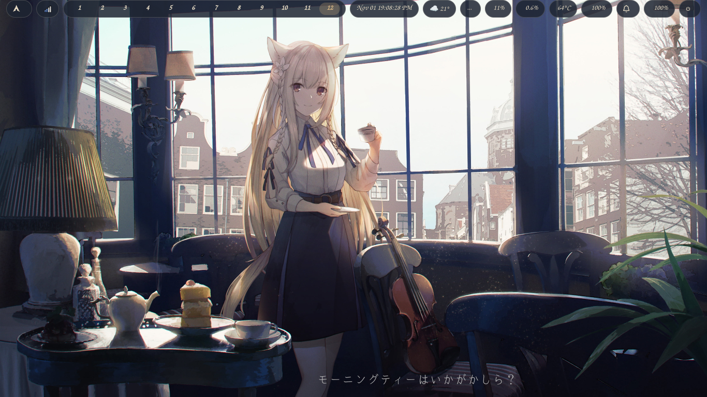
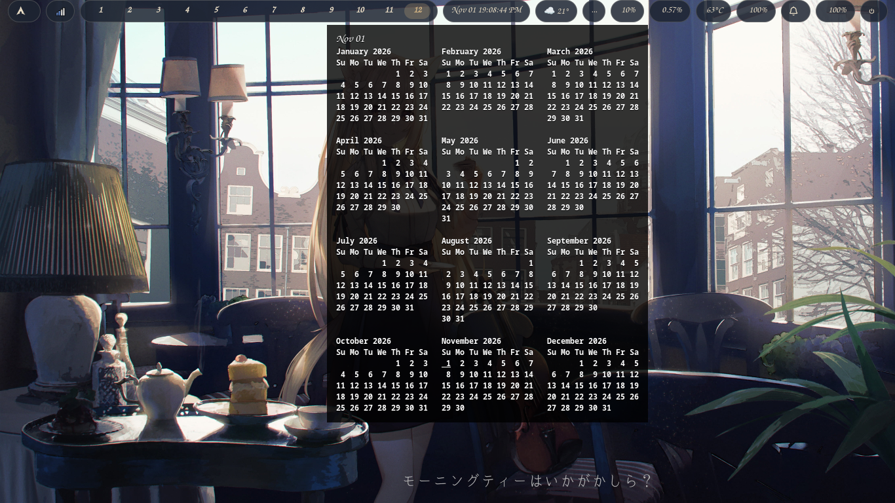
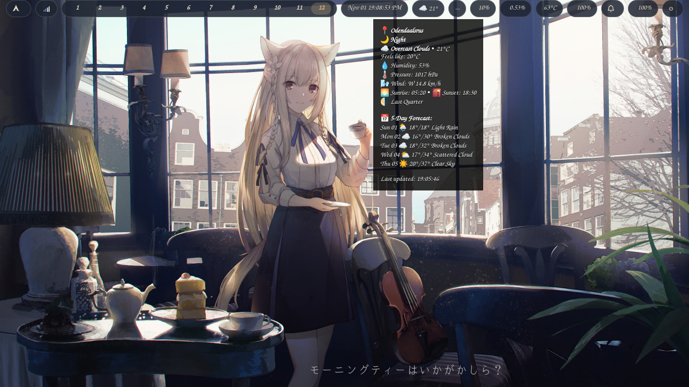
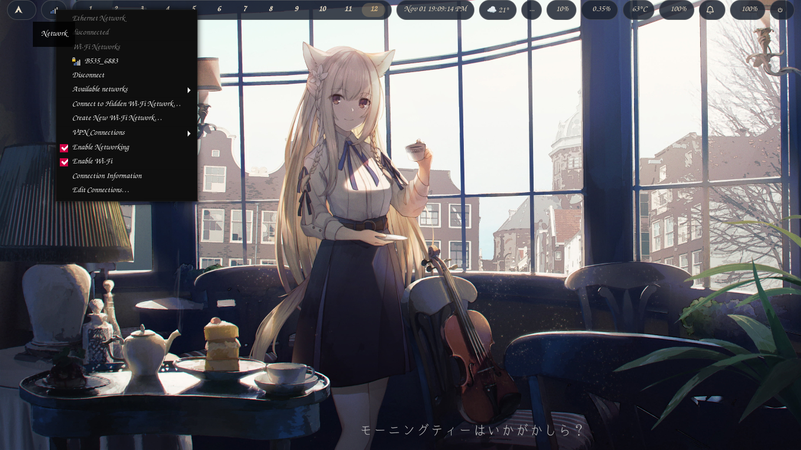
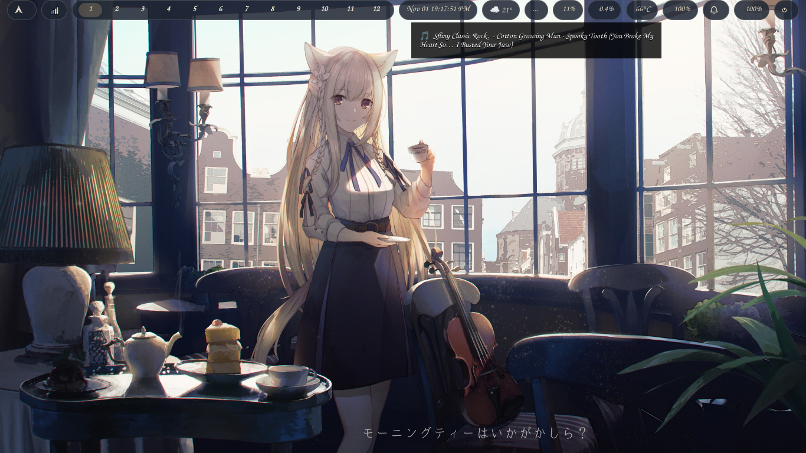
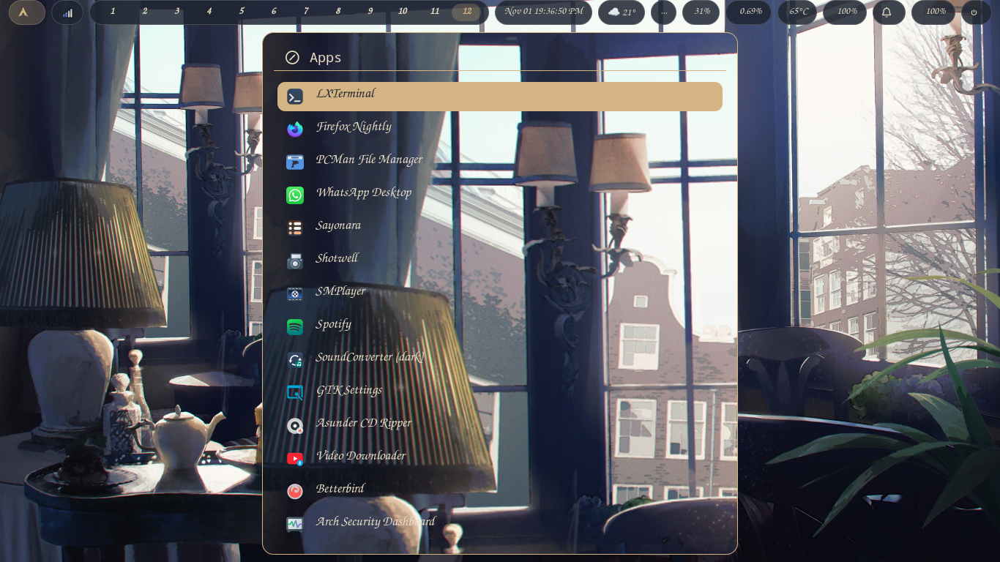
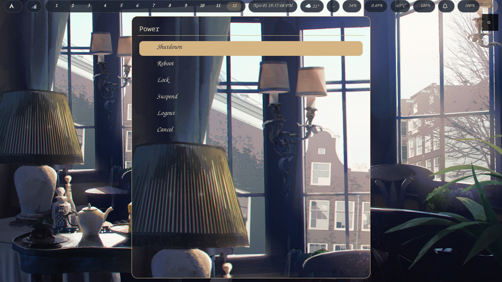

# spitfire Dotfiles

  
  
  
  
  

Smithay-based dynamic tiling Wayland compositor riced with the **Gold & Navy** theme:
12 native workspaces, sheer transparent Waybar, and warm gold accents.

---

## ✨ Features

-   **12 Native Workspaces:** Full workspace support (1–12) with F-key bindings for 10–12, advertised over ext-workspace-v1 for seamless Waybar integration.
-   **Gold & Navy Theme:** Sheer transparent Waybar pills (`rgba(30, 37, 50, 0.85)`), muted navy borders (`#414868`), and warm gold active highlights (`#d4b483`).
-   **Native Screenshot Support:** `Mod4+Shift+F3` captures full-screen screenshots with desktop notifications via `grim`.
-   **Rofi Launcher & Powermenu:** Custom-styled launcher and power menu matching the Gold & Navy aesthetic.
-   **Seamless X11 Bridge:** Pre-configured for flawless X11 app support via clipboard paste workaround.

## 📖 Documentation & Installation

For full instructions, keybinds, theming guide, and gallery, please visit the **[Official Documentation Website](https://wgparch.github.io/spitfire/)**.

Quick setup:

1.  Clone this repository and copy configs: `cp -r configs/spitfire ~/.config/spitfire`
2.  Install dependencies: `sudo pacman -S waybar swaybg nm-applet swaync grim libnotify rofi lxterminal`
3.  Start spitfire from your display manager or terminal.

## 📸 Screenshots

1.  
2.  
3.  
4.  
5.  
6.  
7.  
8.  
9.  
