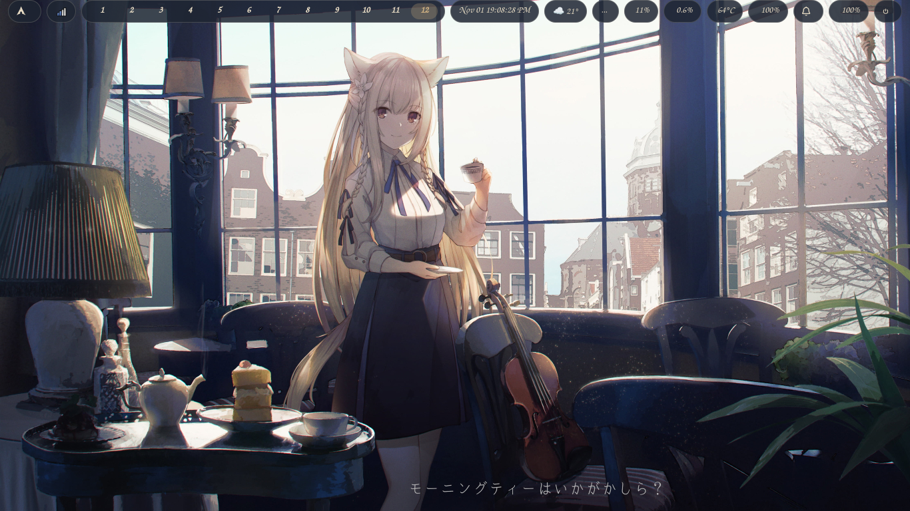
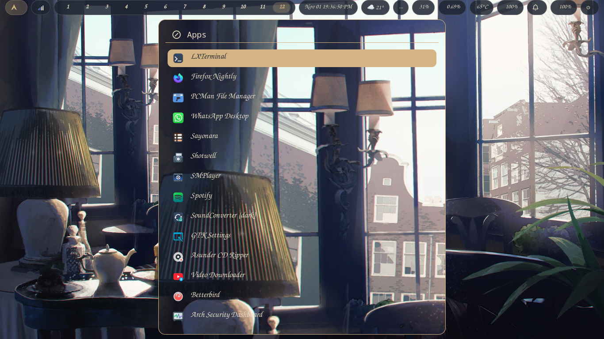
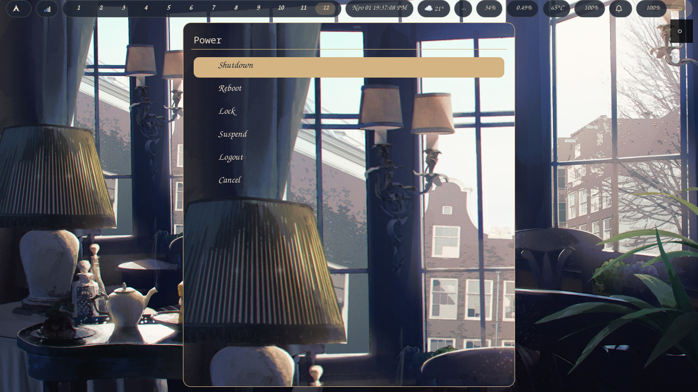
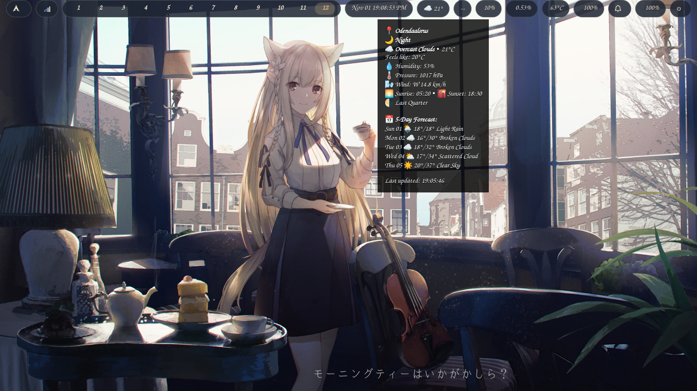
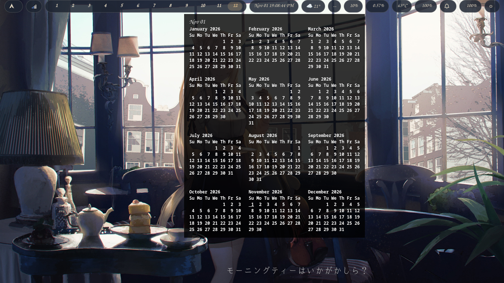
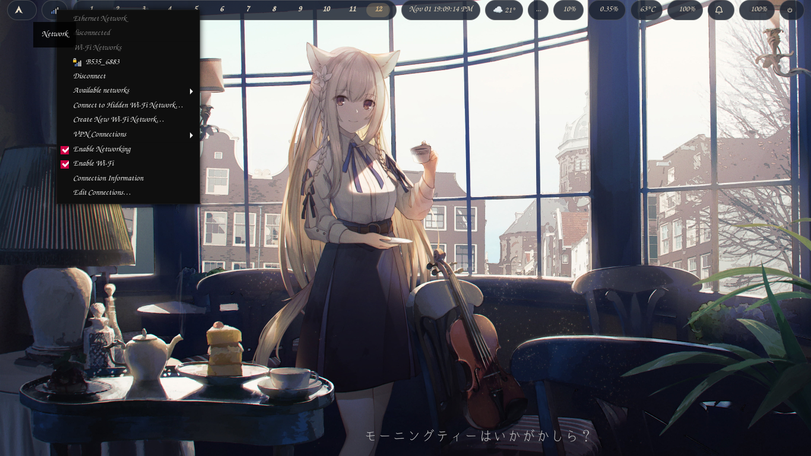

# Screenshot Gallery

Below are screenshots showcasing the Gold & Navy spitfire setup. All images were captured using `Mod4+Shift+F3`.

## Main Desktop

*Clean desktop with Waybar, Violin.jpg wallpaper, and gold-bordered terminal.*

## Rofi Apps Menu

*Application launcher with golden search bar and consistent typography.*

## Power Menu

*Shutdown/reboot options with sheer transparent background.*

## Weather Tooltip

*Current conditions and 5-day forecast with icon integration.*

## Calendar View

*Full-year calendar popup triggered from Waybar clock module.*

## Network Manager

*nm-applet Wi-Fi selection menu with connection status indicators.*
